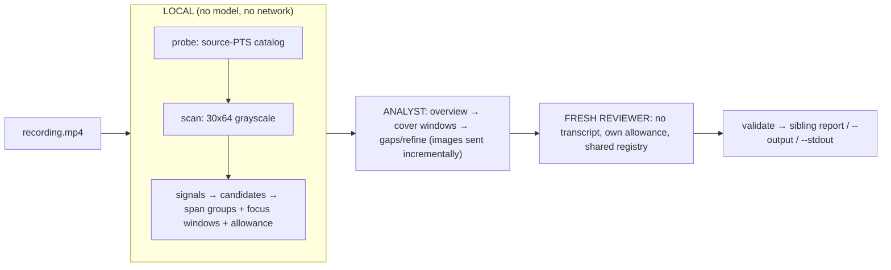

# videbug

Turn a screen recording of a failing app into a **validated, evidence-backed
debugging handoff** with one command.

`videbug` combines a deterministic, source-PTS-accurate video evidence
engine with a constrained Pi vision agent and an independent reviewer. It emits a
concise Markdown or JSON report — a chronology of *debug beats*, flagged anomalies,
and a reproduction/investigation handoff — where **every cited timestamp is a
verified source presentation timestamp (PTS)**, never a filename, output cadence, or
guessed value. It never uploads the whole video, never persists model reasoning, and
fails closed rather than fabricating output.

---

## Why

Existing "video → frames" workflows can produce dangling timeline rows, synthetic
timing, duplicated frames, hard frame-count failures, or missing timecodes. High visual
recall does not excuse corrupt frame-to-time associations. `videbug` treats source PTS
as authoritative and mechanically validates every citation before emitting the report.

## Requirements

- A configured **Pi** provider with a **vision-capable** model (the agent must see
  contact sheets and full-resolution frames). Authenticate with `pi login` or your
  usual Pi credentials.
- The Nix package supplies Node.js 22 and ffmpeg/ffprobe. A non-Nix local development
  build requires **Node.js ≥ 22.19** and **ffmpeg/ffprobe** on `PATH`.

## Install with Nix

The repository is a flake. Run without installing:

```bash
nix run .#videbug -- ./screen-recording.mp4 --output report.md
```

For a declarative install, add the GitHub repository as an input:

```nix
# In your flake inputs:
inputs.videbug.url = "github:jeprecated/videbug";

# In a Home Manager module where `inputs` and `pkgs` are in scope:
home.packages = [ inputs.videbug.packages.${pkgs.system}.default ];

# Or in a NixOS module:
environment.systemPackages = [ inputs.videbug.packages.${pkgs.system}.default ];
```

Alternatively apply the exported overlay and install the normal package attribute:

```nix
nixpkgs.overlays = [ inputs.videbug.overlays.default ];
home.packages = [ pkgs.videbug ]; # or environment.systemPackages
```

Pass `inputs` through your configuration's `specialArgs`/`extraSpecialArgs` when it
is not already in module scope. The wrapper places ffmpeg/ffprobe on the command's
runtime `PATH`; they do not need to be installed separately.

### Name migration

The product, Nix package/app, npm package, schema, manifests, and primary command are
now **`videbug`**. The old `video-to-debug` executable remains as a **temporary
compatibility alias** to the same CLI so existing scripts can migrate; new usage must
prefer `videbug`.

### Local Node development

```bash
npm install          # restore dependencies (exact-pinned Pi SDK)
npm run build        # compile to dist/
node dist/cli.js --help
```

The npm package remains `private` (not published to any registry). Its `files`
allowlist — verified with `npm pack --dry-run` — bundles `dist/`, the label font under
`assets/fonts/`, and the machine-readable schema under `schema/`, so a local pack has
everything required at runtime.

## How it works (in one picture)

**New here? Read [`docs/how-it-works.md`](docs/how-it-works.md)** — an end-to-end walkthrough
with worked examples that explains, in particular, why the big allowance numbers in the
log are a **worst-case safety ceiling, not work sent**.

The deterministic evidence engine (probe → scan → signals → candidates → grouping) runs
**entirely locally**. Only selected contact-sheet cells and a few explicit full-resolution
frames ever cross to the model provider, and they cross **incrementally**, one requested
sheet at a time — never as an up-front batch.



Plain-text fallback:

```text
recording.mp4
  -> LOCAL (no model, no network): probe (source-PTS catalog) -> scan (30x64 grayscale)
                                   -> signals -> candidates -> span groups + focus windows + allowance
  -> ANALYST : overview (navigation) -> cover windows -> status-driven gaps/refine
               (only selected cells + explicit full-res frames cross the provider boundary, incrementally)
  -> FRESH REVIEWER: no analyst transcript, own separate allowance, shared deterministic registry
  -> deterministic validation -> sibling report (or --output / --stdout); progress/warnings to stderr
```

## One-call usage

```bash
# Writes ./screen-recording.videbug.md (default: standard mode)
videbug ./screen-recording.mp4

# JSON report beside the video: ./screen-recording.videbug.json
videbug ./screen-recording.mp4 --format json

# Explicit destination, or stdout for agents/pipelines
videbug ./screen-recording.mp4 --output report.md
videbug ./screen-recording.mp4 --stdout

# Steer the report's focus and presentation
videbug ./screen-recording.mp4 --prompt "focus on the button click and page load"
videbug ./screen-recording.mp4 --prompt "ignore routine recording setup/teardown; be concise"

# Faster/cheaper single-agent pass (no independent reviewer)
videbug ./screen-recording.mp4 --mode fast

# Diagnose the deterministic engine only (no model calls, no cost)
videbug ./screen-recording.mp4 --dry-run
```

### Options

| Option | Meaning |
|---|---|
| `--format markdown\|json` | Output format (default `markdown`). |
| `--output <path>` | Write the report to an explicit path instead of the default sibling file. |
| `--stdout` | Print a complete report to stdout instead of writing a file; partial reports are never printed. |
| `--model <provider/model[:think]>` | Analyst model. An **override**; default: your normal **Pi model selection** (see below). |
| `--review-model <provider/model[:think]>` | Reviewer model (default: analyst model). |
| `--prompt <instruction>` | Steer report emphasis, exclusions, detail, or concision. It cannot disable required inspection or evidence validation. |
| `--mode standard\|fast` | `standard` = analyst + fresh reviewer (default); `fast` = analyst only. |
| `--max-agent-turns <n>` | Cap agent turns per session. |
| `--timeout <seconds>` | Abort the whole run after N seconds and clean up. |
| `--keep-artifacts [<dir>]` | Preserve evidence frames + a run manifest for debugging the tool itself (default: discarded). |
| `--dry-run` | Deterministic engine only; prints a JSON diagnostic, never runs a model. |
| `--quiet` | Suppress stderr progress. |

### Model / auth / vision resolution

`--model` is only an **override**. With **no `--model`**, selection follows your
normal **Pi enabled/default model** semantics through the SDK
(`SettingsManager` + `resolveModelScopeWithDiagnostics`), exactly like the Pi CLI:
your `enabledModels` are resolved to a scope, and the saved default is used when it
is an authenticated member of that scope, otherwise the first scoped model is used.
The saved default's explicit thinking level (or your default thinking level) is
applied. If you have no enabled scope, an exact authenticated saved default is used;
a **stale, missing, or unauthenticated** default is **not** an error — it falls back
to the first auth-configured model, matching Pi.

Two fail-closed gates then apply to the **finally-selected** model: it must **accept
images** and must have **configured auth**. A selected text-only model **fails closed
(exit 4)** and is **never** silently swapped for another (no arbitrary substitution);
when the only fallback candidates are text-only, the run fails closed with guidance to
pass a vision-capable `--model`.

## Output contract (files / stdout / stderr / exit codes)

- By default, a report is written atomically beside the video as
  `<video-stem>.videbug.md` (or `.json` with `--format json`). `--output` selects an
  explicit path; `--stdout` prints a complete report for agents and pipelines.
- **All progress and diagnostics go to stderr.** Stdout contains only a final, fully
  validated report when `--stdout` is selected (or the JSON diagnostic from `--dry-run`).
- A validated **partial** result is retained by file destinations (the default or
  `--output`); stdout stays empty and the process exits **5**. This prevents piping a half-analysis downstream. Production
  auto-coverage rejects a partial while any obligation's required allowance remains
  (range + cells for chronology gaps; full-resolution reads for isolated peaks). In
  standard mode, even `accept` revalidates the retained draft against the reviewer's fresh
  live ledger, so it cannot preserve an avoidable analyst partial. Exit 5 therefore
  requires an agent to have submitted an honest structured partial after
  actual inspection exhaustion (or an explicit frozen-evaluation constraint). Provider,
  timeout, turn, and cancellation failures normally abort without a partial payload.

| Exit | Meaning |
|---|---|
| 0 | Complete, validated analysis. |
| 2 | Invalid arguments or unsupported input. |
| 3 | ffmpeg/ffprobe/probing/extraction failure. |
| 4 | Pi auth/model unavailable, or the model lacks image support. |
| 5 | A validated structured partial was submitted after actual inspection constraints; retained only with a file destination. |
| 6 | Agent failed to submit a valid result. |
| 7 | Reviewer rejected the result without a valid replacement. |

### Progress on stderr

By default (unless `--quiet`), stderr shows one compact, **deterministic** line per
step so you can see exactly what is being inspected and how much of the checklist and
budget remains. It reports **phase and counter state**, never a wall-clock percentage:
model/reviewer latency is unpredictable, so the honest signal is the mandatory-window
checklist, exact budget counters, and `turn N/max` — not a fabricated ETA. Progress
never prints model reasoning, prompt text, frame contents/visible text, or draft payloads.

```text
[candidates] candidates by kind: 79 boundary, 41 stable, 4 local-animation, 55 transient
[allowance] analyst allowance (auto-scaled): ceiling 95 range · 2931 cells · 30 full-res (worst-case cap, not work sent); initial plan ~23 inspection(s) / ~312 cells; 22 actual mandatory window(s) + up to 52 gap close(s) + 8 isolated peak read(s)
[plan] analyst plan: 22 mandatory window(s) to cover (3 dense, 0 isolated); allowance 95 range · 2931 cells · 30 full-res; overview is navigation, not coverage
[analyst] turn 2/20
[analyst] overview: 42 cell(s) sampled; mandatory 0/22 covered; cells 42/2931; 42 frame(s) registered (navigation, not coverage)
[analyst] range 00:12.000–00:23.000 (chronology): 18 frame(s); mandatory 3/22 covered; range calls 3/95; cells 96/2931; 2 large gap(s) remain
[analyst-validated] analyst draft validated (21 beat(s), status complete; 1 submit attempt(s), 0 rejection(s))
[reviewer] handing the validated analyst draft to a fresh independent reviewer (no analyst transcript)
[allowance] reviewer allowance (auto-scaled): ceiling 86 range · 2482 cells · 19 full-res (worst-case cap, not work sent); initial plan ~23 inspection(s) / ~312 cells; 22 actual mandatory window(s) + up to 52 gap close(s) + 8 isolated peak read(s)
[plan] independent reviewer plan: 22 mandatory window(s) to cover (3 dense, 0 isolated); allowance 86 range · 2482 cells · 19 full-res; own independent ledger; overview is navigation, not coverage
[reviewer-verdict] reviewer verdict: accept
```

The reviewer runs on its **own independently auto-sized ledger**, so its counters are
separate from the analyst's. `--quiet` suppresses all of the above.

## What the report contains

- `summary` — the observed failure (or an honest *no visible failure*) and a
  chronology.
- `beats[]` — contiguous debug beats: time range (with `precisionMs`), a visible-state
  observation (`summary`, `visibleText`, `motion`), `evidence[]` citations, a
  confidence, and any explicitly-labelled `inferences[]`.
- `anomalies[]` — categorized findings (`loading`, `contradictory-state`,
  `persistent-overlay`, `failed-action`, `incremental-render`, `navigation`, `other`)
  with severity, evidence, and separated inference/uncertainty.
- `coverage` — the analyzed window and any `uninspectedRanges` (canonical, runtime-owned).
- `handoff` — reproduction steps, suggested investigations, and uncertainties.
- `source` / `provenance` — deterministic fingerprint (sha256, duration, resolution,
  fps) and run provenance (models, tool version, inspection counts). **Injected by the
  CLI; the model never supplies these.**

JSON is canonical; the Markdown renderer is a pure function over the validated JSON.
The machine-readable JSON Schema is
[`schema/analysis-result.v1.schema.json`](schema/analysis-result.v1.schema.json); see
[`docs/schema.md`](docs/schema.md).

## Privacy

- Only **selected frames** (low-resolution contact-sheet cells and a small number of
  full-resolution frames the agent explicitly requests) are sent to your configured
  model provider. **The full video is never uploaded.**
- Temporary artifacts (extracted frames, contact sheets, workspaces) are created in a
  private directory with **user-only (0600/0700) permissions** and **deleted on exit**
  — on success, failure, timeout, or Ctrl-C — unless you pass `--keep-artifacts`.
- **No model reasoning, chain-of-thought, transcripts, or tool payload dumps are ever
  persisted.** Provenance is counts only (inspection calls, cells, full-res frames).
- Visible text inside the recording is treated as **untrusted data** (potential prompt
  injection), never as instructions. See [`docs/architecture.md`](docs/architecture.md).

## Allowances, runtime, and cost

**Production auto-coverage (default).** By default the CLI does **not** stop at a
fixed budget. After the deterministic engine runs, it computes a **generous per-video
allowance** from the recording's duration and isolated-transient complexity
complexity, sized so the analyst (and the independent reviewer) can complete **every**
mandatory window, **every** ≥5 s chronology gap, and their refinement/full-resolution
obligations. The allowance is logged on stderr, and a long/busy recording prints a
warning.

Three different numbers appear in the log — **do not confuse them.** For the ~4:18 /
179-candidate reference video:

| For the 258.228 s / 179-candidate reference video | Analyst | Reviewer |
|---|---:|---:|
| **Ceiling** — `inspect_range` calls (worst-case cap) | ~95 | ~86 |
| **Ceiling** — contact-sheet cells (worst-case cap) | ~2,931 | ~2,482 |
| **Ceiling** — full-resolution frames | ~30 | ~19 |
| **Initial planned** — inspections (≈ typical) | ~23 | ~23 |
| **Initial planned** — cells (≈ typical) | ~312 | ~312 |
| **Actual usage** in a prior real run (combined) | ← 20 calls / 294 cells / 2 full-res → | |

> The **2,931 cell** figure is a **worst-case analyst safety ceiling, not work done and
> not a batch that is automatically sent.** It is `95 × 24 + 8 × 48 + 10% headroom`
> (range calls × 24 cells max, plus 8 overview sheets × 48 cells, plus slack). Only cells
> in **successfully requested** contact sheets and **explicitly requested** full-res
> frames cross the provider boundary, **incrementally**. A real run used **294** cells.
> See [`docs/how-it-works.md`](docs/how-it-works.md).

The count ledgers still exist as **runaway guards and usage telemetry** — a rejected
request spends nothing, and provenance reports **actual** spend, never the allowance
ceiling. Short/simple recordings stay near a sensible minimum (never below the
historical 12/250/12 analyst and 6/125/6 reviewer floors). There is **no arbitrary
evaluation cap that blocks your analysis**, and no new flag is required.

A standard run makes two independent model sessions (analyst + reviewer). Cost scales
with your chosen model and the number of frames actually inspected; a long/busy video
can send materially more images than a short one (the warning states the estimate).

**Frozen evaluation budgets.** The committed evaluation was run with the historical
budgets **frozen at 12/250/12 (analyst) + reviewer half** for reproducibility. To
reproduce those runs, set `VTD_FIXED_BUDGETS=1` (the evaluation adapters set it
automatically); this pins the frozen budgets instead of auto-scaling.

## Guarantees and limitations

**Guarantees**
- Every evidence citation references a real source frame; its embedded PTS must
  exactly match the cited `ptsMs` and lie within the source duration, or validation
  fails.
- Frame counts and PTS are validated against the source catalog; count/PTS/duplicate
  mismatches fail closed (CFR and VFR).
- Coverage completeness is decided by deterministic run state, not model claims.

**Limitations**
- **No audio.** Analysis is visual-only.
- **No tap/pointer reconstruction and no source-code access.** Timing is dated to the
  first *visible* state change, not to an inferred input event. A loading beat starts
  at the first visible loading frame, not at an (invisible) tap.
- Sampling/vision cannot guarantee capture of every sub-frame micro-flash; brief
  events with tiny text may be missed. The tool reports honestly rather than inventing.
- The agent's semantic judgment is model-dependent; the independent reviewer reduces
  but does not eliminate error.

## Troubleshooting

See [`docs/troubleshooting.md`](docs/troubleshooting.md) for common failures (exit 3
ffmpeg issues, exit 4 model/auth/vision, exit 5 partial results, exit 6/7 agent/review
failures). For what the allowance/ceiling numbers mean, see
[`docs/how-it-works.md`](docs/how-it-works.md).

## Development

```bash
npm run typecheck && npm run lint && npm test && npm run build
npm run schema:export     # regenerate the tracked JSON Schema from the TypeBox contract
```

How it works end to end: [`docs/how-it-works.md`](docs/how-it-works.md). See also the
[architecture and security boundaries](docs/architecture.md), the
[output schema](docs/schema.md), and [troubleshooting guide](docs/troubleshooting.md).

## License

The source is available under the [MIT License](LICENSE). The bundled JetBrains Mono
font remains licensed separately under the SIL Open Font License in
[`assets/fonts/OFL.txt`](assets/fonts/OFL.txt).
