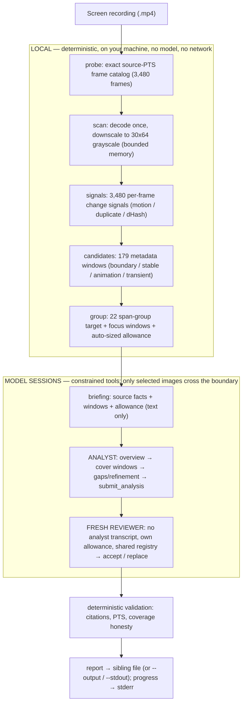

# How `videbug` works

This document explains, end to end, what the tool actually does with your recording —
and, importantly, **what the big numbers in the progress log mean**. If you have ever
looked at a line like `ceiling 95 range · 2931 cells · 30 full-res` and worried that
2,931 frames are about to be shipped to a model, this page is for you.

Short version:

- The whole **evidence engine is local**: probing, the low‑resolution scan, per‑frame
  change signals, candidate detection, and window grouping never leave your machine.
- Only **selected contact‑sheet cells and a few explicit full‑resolution frames** ever
  cross the provider boundary, and they cross **incrementally**, one requested sheet at
  a time — never as an up‑front batch.
- The large allowance numbers are a **worst‑case safety ceiling**, not planned work and
  not a batch that is automatically sent.

---

## The three numbers you must not confuse

Using the real worked profile below (a 258.228 s / 4:18 recording):

| Number | Analyst | Reviewer | What it is |
|---|---:|---:|---|
| **Ceiling** (`inspect_range`) | 95 | 86 | Worst‑case runaway guard. A hard cap the model can never exceed. **Not** work planned or sent. |
| **Ceiling** (contact‑sheet cells) | 2,931 | 2,482 | Worst‑case cap on total cells. Only reached if the model exhausts everything. |
| **Ceiling** (full‑resolution frames) | 30 | 19 | Worst‑case cap on single full‑res reads. |
| **Initial planned** (inspections) | ~23 | ~23 | Illustrative when the constructed context has 22 mandatory windows: 1 overview + those actual windows. |
| **Initial planned** (cells) | ~312 | ~312 | Computed after context construction from the actual window count, including focus windows. |
| **Actual usage** (a real run) | 20 calls / 294 cells / 2 full‑res (combined) | | What actually crossed the boundary last time. Reported live as `used/limit`. |

The progress log states all three explicitly, e.g.:

```text
[allowance] analyst allowance (auto-scaled): ceiling 95 range · 2931 cells · 30 full-res (worst-case cap, not work sent); initial plan ~23 inspection(s) / ~312 cells; 22 actual mandatory window(s) + up to 52 gap close(s) + 8 isolated peak read(s)
[warning] long/busy recording (04:18.228): the safety ceiling allows up to ~2931 frames across ~133 images IF fully exhausted — this is a worst-case cap, not a batch sent up front. Frames cross to the model provider incrementally, only as contact sheets/full-res reads are requested; actual usage is reported per inspection and is typically far lower.
```

> **2,931 is a worst‑case analyst safety ceiling, not work done and not a batch that is
> automatically sent.** It is `95 × 24 + 8 × 48 + 10% headroom` = `2280 + 384`, then
> `× 1.1` ≈ **2,931** (95 range calls × 24 cells max each, plus 8 overview sheets × 48
> cells, plus 10% slack so cells never bind before range calls). If a run genuinely
> exhausted the ceiling, then yes — all of those selected cells would have been sent and
> processed. In practice a run uses a small fraction of it (the prior real run: 294
> cells total).

---

## The pipeline



Plain‑text fallback (same flow):

```text
Screen recording (.mp4)
        |
  ┌─────────────────────── LOCAL (deterministic, no model, no network) ───────────────────────┐
  |  probe    -> exact source-PTS frame catalog (3,480 frames)                                  |
  |  scan     -> decode once, downscale every frame to 30x64 grayscale (bounded memory)         |
  |  signals  -> 3,480 per-frame change signals (motion / duplicate / dHash)                    |
  |  candidates -> 179 metadata windows (boundary / stable / local-animation / transient)       |
  |  group    -> 22 span-group target + focus windows + auto-sized allowance                     |
  └─────────────────────────────────────────────────────────────────────────────────────────┘
        |
   briefing (text only: source facts + windows + allowance)
        |
  ┌─────────── MODEL SESSIONS (constrained tools; only selected images cross the boundary) ────┐
  |  ANALYST : overview -> cover mandatory windows -> status-driven gaps/refinement -> submit    |
  |  REVIEWER: fresh (no analyst transcript), own allowance, shared registry -> accept/replace   |
  └─────────────────────────────────────────────────────────────────────────────────────────┘
        |
  deterministic validation (citations resolve to real frames, exact PTS, coverage honesty)
        |
  report -> sibling file (or --output / --stdout);   progress/warnings -> stderr
```

---

## Stage by stage

### 1. Deterministic evidence engine (LOCAL)

Everything in this stage runs on your machine with `ffmpeg`/`ffprobe` and pure code. No
model is involved and nothing leaves the process.

- **probe** builds an exact **source‑PTS frame catalog** — for the worked profile,
  **3,480 frames**, each with its authoritative presentation timestamp. This catalog is
  the single source of truth for time; citations are validated against it later.
- **scan** decodes the video **once**, downscaling every frame to a tiny **30×64
  grayscale** image, consumed as a bounded stream (only the current and previous tiny
  frames are held). This is why the scan is cheap even for long videos — it is a
  motion/index pass, not OCR or vision.
- **signals** computes **3,480** deterministic per‑frame change signals (mean pixel
  diff, changed‑pixel ratio, an 8×8 motion grid, a difference hash, duplicate/near‑
  duplicate status). These are numbers only; they assert no meaning.
- **candidates** turns runs of those signals into **179 candidate windows** of four
  kinds: `boundary` (hard cut), `stable` (long quiet), `local-animation` (sustained
  localized motion, e.g. a spinner), and `transient` (a short burst between stable
  states).

> **179 candidates are metadata time‑windows, not cells and not images.** A candidate
> is just “something changed here, look later.” None of them are frames sent anywhere.

### 2. Grouping and the plan (LOCAL)

179 candidates would be an unusable to‑do list, so they are **grouped** deterministically
into **balanced, targetable mandatory windows** — a **22 span-group target** for the worked
profile (roughly one window per ~12 s of video, floor 10, with no fixed production cap).
The actual runtime count is computed after adding dense and isolated focus windows and is
printed in `[allowance]` and `[plan]`. Grouping is what keeps
a busy recording from turning into 179 separate sheets: **the plan size is decoupled from
the allowance ceiling.** A high allowance does **not** create more mandatory windows.

Each mandatory window is coverable by a single `inspect_range` call. The remaining
allowance beyond “cover every window once” is deliberate **refinement headroom** (for
boundary tightening, loading‑edge reads, and closing status‑reported gaps).

### 3. The auto‑coverage allowance (LOCAL)

From duration and isolated-transient complexity, the tool derives a
**generous per‑video allowance** sized so the analyst — and the independent reviewer —
can complete **every** mandatory window, **every** ≥5 s chronology gap (up to **52** here),
and their refinement/full‑resolution obligations. The count ledgers still exist as
**runaway guards and usage telemetry**; a rejected request spends nothing, and provenance
reports **actual** spend, never the ceiling.

Per‑range sampling is capped at **24 cells** — that is where the `95 × 24` in the ceiling
comes from.

### 4. Briefing (text only)

The analyst is given a **text** briefing: source facts (basename, duration, resolution,
fps), the candidate summary, the mandatory windows, and its allowance. **No frames are in
the briefing.** The analyst has never seen the raw video and has no filesystem, shell,
network, or code tools — only the five constrained inspection tools plus `submit_analysis`.

### 5. The analyst loop (images cross the boundary here, INCREMENTALLY)

The analyst works the plan through tools. Each tool call is the **only** point where
image data crosses to the model provider, and it happens **one requested sheet at a time**:

- **`inspect_overview`** — one whole‑duration contact sheet for orientation. The overview
  is **navigation, not coverage**: it never marks a mandatory window or a large gap as
  inspected. It just helps the analyst decide where to look.
- **`inspect_range`** — samples explicit source frames in a `[startMs, endMs]` window at a
  chosen density (**≤24 cells**), returns a contact sheet + an authoritative cell→frame‑ID
  manifest, and marks that range inspected.
- **`inspect_frame`** — one **full‑resolution** frame by registered ID, for reading small
  text or a brief flash.
- **`compare_evidence`** — deterministic pixel‑diff numbers between two registered frames
  (no image is added; it reports metrics only).
- **`get_inspection_status`** — remaining allowance (used/limit), which mandatory windows
  are still uninspected, and any large uninspected gaps. This is **status‑driven**: the
  runtime, not the model, decides what still needs covering, so the analyst closes exactly
  the reported gaps and refines boundaries until coverage is complete.

Only the cells in **successfully requested** contact sheets and the **explicitly
requested** full‑resolution frames are ever sent — incrementally, as each call is made.

### 6. The fresh independent reviewer

Standard mode then runs a **genuinely fresh reviewer**:

- It receives the analyst's **validated structured draft** and the same deterministic
  briefing — but **no analyst transcript or reasoning**.
- It has its **own separate allowance** (independent ledger), auto‑sized to be sufficient
  to close any gaps the analyst left.
- It **shares the analyst's deterministic evidence registry** (the already‑extracted
  frames), so it can cite known frames cheaply and extract new ones into the same private
  workspace.
- It either **accepts** the draft unchanged or submits a **complete replacement** that
  passes the same validator. An `accept` is not a bypass: the retained draft is revalidated
  against the reviewer's live coverage and fresh ledger. If the analyst draft is partial
  while the reviewer can still close its gaps/peak reads, `accept` is rejected; after
  completing coverage the reviewer submits a complete replacement because accepting cannot
  change the draft's stale partial status. There is no patch/merge form.

### 7. Validation and output

Before anything is emitted, the result is **deterministically validated**: every citation
must resolve to a real registered frame with an exact source PTS inside the duration, no
duplicate frame is presented as independent evidence for two beats, and coverage claims
must match the runtime’s own uncovered‑segment state.

- By default, the report is written beside the source as
  `<video-stem>.videbug.md` (or `.json` with `--format json`).
- `--output <path>` selects an explicit file; `--stdout` prints a complete report for
  agents and pipelines. File writes are atomic and use `0600` permissions.
- **stderr** receives all progress, the allowance notice, and warnings.

### 8. When is a result “partial”?

With auto‑coverage, a **partial** result is **rare and specific**: the submit validator
**rejects a premature partial** while deterministic uncovered segments remain and their
required resource is usable — range + cell allowance for chronology gaps, or
full-resolution allowance for unread isolated peaks. The same live check applies to a
reviewer `accept`, not only to replacements. Exit 5 is possible only when an agent successfully
submits an honest structured partial after actual ledger exhaustion (or under the explicit
frozen-evaluation profile). Provider, `--timeout`, turn-limit, and cancellation failures
normally abort without any partial payload. A validated partial is retained for the
normal sibling file or `--output`; it is never printed by `--stdout`, and the command exits `5`.

---

## What actually crosses the provider boundary

| Stays LOCAL (never sent) | Crosses to the model provider (incrementally) |
|---|---|
| The original video file | Contact‑sheet PNGs for **successfully requested** ranges/overview |
| The 30×64 grayscale scan and all 3,480 signals | **Explicitly requested** full‑resolution frames (`inspect_frame`) |
| Candidate windows, grouping, mandatory‑window plan | The text briefing (facts, windows, allowance — no pixels) |
| Frame catalog, PTS, coverage bookkeeping | — |

The full video is **never** uploaded. Temporary frames/sheets live in a private `0600`
workspace and are deleted on success, failure, timeout, or Ctrl‑C (unless
`--keep-artifacts`). No model reasoning, transcripts, or payload dumps are ever persisted.

---

## Worked examples

### A) Short / simple recording (~20 s, 8 candidates)

- The span planner has a 10-group sizing floor, but the constructed context uses the
  actual candidate and focus windows; the logged initial estimate is derived from that
  actual count (for example, 8 actual windows means 9 initial inspections, not 11).
- **Analyst ceiling:** ~30 range · ~1,215 cells · ~20 full‑res. **Reviewer:** ~24 · ~845 · ~14.
- **Initial planned for 8 actual windows:** ~9 inspections / ~144 cells.
- Real usage will typically be a handful of sheets. The ceiling stays near the sensible
  minimum (never below the historical 12/250/12 analyst and 6/125/6 reviewer floors), and
  **no long/busy warning** is printed.

### B) This long / busy recording (258.228 s, 179 candidates) — the worked profile

- **3,480** source frames → 30×64 scan → **3,480** signals → **179** candidates →
  **22 span-group target** plus any focus windows; up to **52** possible ≥5 s gaps.
- **Analyst ceiling:** **95** range · **2,931** cells · **30** full‑res.
  **Reviewer ceiling:** **86** · **2,482** · **19**.
- **Initial planned if the constructed context has 22 actual windows:** ~23 inspections /
  ~312 cells; runtime logs the exact count after focus windows are included.
- **Actual usage in a real run:** **20** successful calls, **294** cells, **2** full‑res —
  i.e. ~10% of the analyst cell ceiling. This is why the earlier fixed 12/6 caps forced a
  useless partial even though plenty of provider budget remained; auto‑coverage fixes that
  while the ceiling remains a guard, not a plan.

### C) Recording with an isolated transient (e.g. a leaked debug string flash)

- Suppose a 128.6 s recording with 51 candidates and **1** isolated transient (a brief
  flash on an otherwise held/blank screen).
- The isolated transient gets its **own mandatory focus window**, and its **peak frame
  must be read at full resolution** (`inspect_frame`) and its literal text transcribed —
  a dense contact sheet alone does **not** satisfy it.
- Isolated focus windows/peaks are **auto‑sized to the detected count** (with minimum
  floors of 4 windows / 8 peaks), so a real transient is never dropped by a fixed cap.
- Example ceilings: analyst ~53 range · ~1,831 cells · ~20 full‑res; reviewer ~47 · ~1,457 · ~14.

---

## Frozen evaluation mode (reproducibility)

The committed evaluation was run with the historical budgets **frozen at 12/250/12
(analyst) + reviewer half** for reproducibility — these remain the auto‑scaling
**minimums**. Set `VTD_FIXED_BUDGETS=1` (the evaluation adapters set it automatically) to
pin those fixed budgets instead of auto‑scaling. Under the frozen budgets a genuinely
long/busy video can legitimately be forced to a partial when the fixed budget is exhausted
— which is exactly the constraint auto‑coverage removes for normal runs.

---

## See also

- [`../README.md`](../README.md) — install, usage, output/exit contract, allowances table.
- [`architecture.md`](architecture.md) — module‑level design and trust boundaries.
- [`troubleshooting.md`](troubleshooting.md) — exit codes, including exit 5 (partial).
